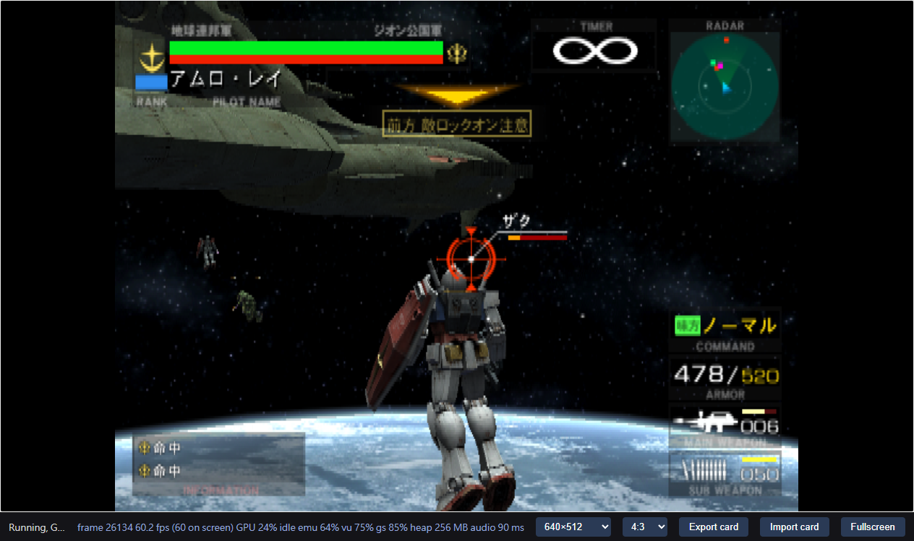
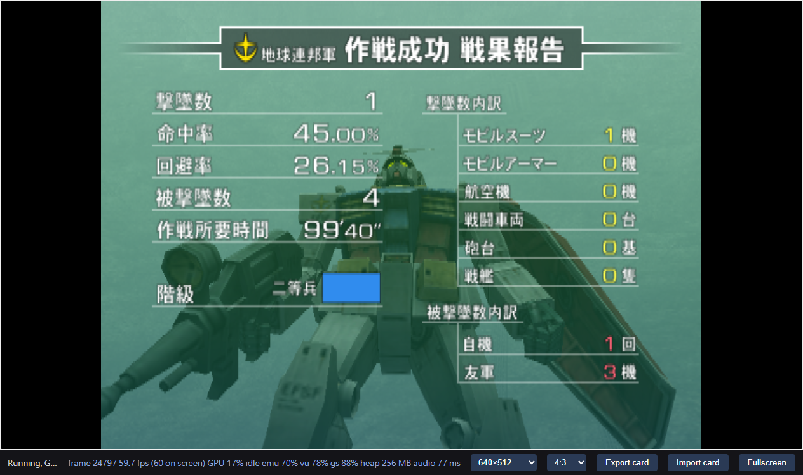
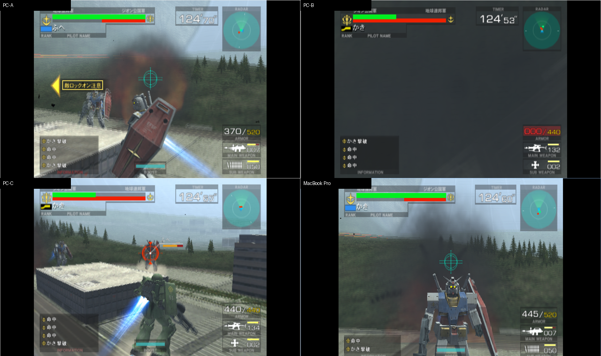
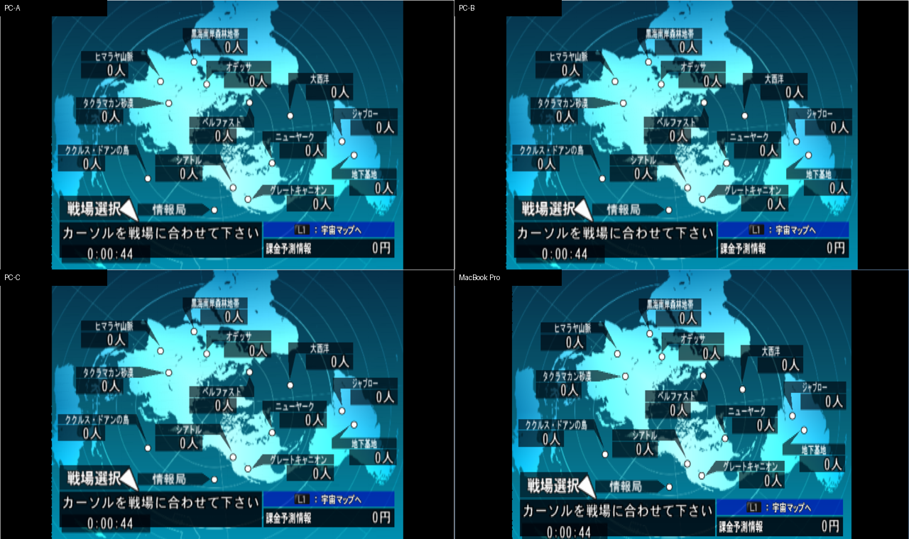

# The same method, verified on a different game

Starting from <a href="https://sennett-lau.github.io/re-gvs-gvzg/">the GVZG research</a>, this project recompiles <strong>Kidou Senshi Gundam — Renpou vs. Zeon DX</strong> to run in a browser. The question: how much of the workflow built for the first game can be reused?

> [!IMPORTANT]
> **The `0.1.0` baseline stops at a verifiable basic port.** Its scope is original boot, input, Arcade battle, the return flow and the necessary fixes, keeping the original timing model. A later Online Mode experiment (2026-11-09) completed a 2v2 run with four independent clients on two machines; see Further work below. That opt-in build and its private server do not change the baseline. No public game or backend service is hosted.

<figure class="hero-evidence">

<figcaption>Real PC browser screenshot: stage 2 after the Side 7 victory. This flow test used the original difficulty 1 and an infinite timer. The speed figure below comes from a separate battle recording.</figcaption>
</figure>

<strong>≈ 60 Hz</strong>measured in one PC battle interval

<strong>0</strong>baseline compiler/runtime-specific patches

<strong>4 / 4</strong>clean-rebuild web outputs byte-identical

## 01 · The method carried over from GVZG

[GVZG](https://sennett-lau.github.io/re-gvs-gvzg/) built a research workflow from the disc through R5900 instructions and generated C++ to WebAssembly and a browser runtime, and only then looked at performance, frame rate and multiplayer. The FVZDX baseline redoes **the basic port workflow**; the later connection experiment is recorded separately in section 06.

The method can be reused, but each game's ELF, addresses, callbacks, overlays and VU programs must be confirmed again. GVZG test results do not automatically become FVZDX evidence.

<ol class="method-flow">
<li><b>Confirm the input</b>Disc identity → ELF → pinned tools</li>
<li><b>Recompile</b>R5900 → C++ → WebAssembly</li>
<li><b>Verify in practice</b>Normal boot → input → battle → return</li>
</ol>

The disc tested is the Japanese `SLPM-65076`, `VER = 2.00`, NTSC. The compiler and runtime are pinned at `6526f480…`; the full identity is in [upstream.lock](../upstream.lock). Testing started from a normal boot with real keyboard input and did not use save states to skip into battle.

## 02 · Which findings carried over?

| Practice from GVZG | How FVZDX verified it this time | Result |
| --- | --- | --- |
| Pin tool versions; keep original input, generated source and runtime separate | Independently checked the new disc and ELF; kept hashes for every source and build | **Carried over.** It is clear which artifact was actually tested |
| A successful compile is not a working game | Played from normal boot through machine selection, battle, Continue and back to the main menu | **Carried over.** Runtime evidence is required |
| Separate display FPS, game speed and audio running | Timestamps and a frame counter measured speed; the browser was muted while the AudioContext and ring consumption kept running | **Carried over.** One battle interval measured about 60 Hz |
| Keep the matched C++/WASM and also rebuild cleanly | New build directory, retained C++ recompiled, no old game objects used | **Carried over.** All four web outputs were byte-identical |
| Game-specific patches need evidence from that game | No GVZG address fixes, overlays or adaptive hooks were ported | **Not needed so far.** The tested route uses the pristine compiler and runtime |
| Observe VU usage instead of guessing | No VU1 program was recorded on the boot, menu and Side 7 route; the EE translation contains VU0 macro operations | **Measure per game.** This does not mean no mode uses VU1 |

> [!IMPORTANT]
> **The most useful reuse is the process and the verification method.** For the specified route, FVZDX ran with an unmodified compiler and runtime. That result does not depend on applying GVZG's fixes.

The additional [compiler provenance check](evidence/compiler-provenance.json) rebuilt from the same pinned upstream revision: 7 object files and the `eerecomp` and `vurecomp` binaries were byte-identical to the retained ones. This supports the "pristine compiler" claim beyond merely checking for extra patches.

### Did the original defects reappear?

GVZG had to extract **325 MWo3 modules** separately, and had to fix problems such as zero-filled memory being treated as fixed code and external tail calls being rejected, before its route ran. See [GVZG's code discovery research](https://sennett-lau.github.io/re-gvs-gvzg/01-disc-to-code.html).

For FVZDX, a bounded scan of the first 16 bytes of each entry in the two AFS archives (1,629 and 2,319 entries) found no MWo3 or SNR2 header, and the tested flows showed no missing-code halt, so neither the module extractor nor the compiler patches were brought over. **This means "not needed on this route", not that the original defects have gone away.** A header scan also cannot rule out deeper, compressed code.

## 03 · What new findings came out of this run?

### Copying files from macOS can make CMake compile the wrong files

The first time the generated C++ was copied to the PC, the archive carried AppleDouble `._unit_*.cpp` and `._table.cpp` files. The upstream CMake collects sources with `*.cpp`, so it picked up this metadata as well, and Clang reported binary/null-byte errors.

**The fix sits in the input-validation layer.** The copy excludes sidecar files, and before building, the file names, lengths and SHA-256 values are compared against the generated manifest. Any extra, missing or modified file stops the build. The vendored code is untouched.

This is a **concrete upstream improvement candidate**: have the recompiler emit a manifest and have the build verify it, or at least reject AppleDouble files with an actionable error. A regression test that needs no game data already exists in this repository. The trigger and the proposal are in [ps2-web-re-pr.md](../ps2-web-re-pr.md); no pull request has been submitted.

### Test tooling can also produce false results

- **Fixed waits can miss a menu fade.** A screenshot named `battle-start` actually still showed pilot-name entry. Later runs continued from what was really on screen instead of judging pass or fail by file name.
- **A missing optional favicon is not missing game data.** The server now returns 204 when the icon is absent, and a fresh browser run confirmed it.
- **A WSL server needs a clear lifecycle.** The background server exited when a single SSH call ended. The serving session was kept alive to recover; the failed record is retained, and data from the interrupted period is not used for performance numbers.
- **General reverse-engineering tools may not support PS2 MIPS.** The providers available this time could not analyze this architecture; the dedicated R5900 recompiler and the file parsing still completed the port. A tool refusing the binary is not recorded as a successful decompile.

These findings made the rebuild process more reliable. The tested game route has not so far reproduced any new EE compiler or runtime correctness defect.

## 04 · Which steps were actually verified?

**✅ Verified · the specified PC Chrome/WebGPU route**

| Scope | Measured result | Evidence |
| --- | --- | --- |
| Boot and input | Original menu; faction, pilot, machine and weapon selection; move, shoot, boost, pause/resume | [Baseline acceptance](evidence/acceptance-0.1.0.json) |
| Flow after losing | Continue countdown, Game Over, faction result, return to the main menu | [Baseline acceptance](evidence/acceptance-0.1.0.json) |
| Original speed | One active-battle interval: 3,305 frames ÷ 55.07208 s = **60.01226 Hz**; audio processing kept running | [Timing record](evidence/acceptance-0.1.0.json) |
| Victory and next stage | Side 7 success → stage 2 briefing → active space battle; difficulty 1, infinite timer | [Follow-up](evidence/baseline-followup.json) |
| Save and reload | The original game saved difficulty 2; after a reload in the same browser profile and origin it was restored, with identical card bytes | [Follow-up](evidence/baseline-followup.json) |
| Rebuild | Retained C++ recompiled in a new WSL workspace; HTML, JS, WASM and data were all identical | [Rebuild](evidence/retained-source-rebuild.json) |

*The victory flow was verification added later, using the same accepted build; it is not a new game feature or a separate release.*

> [!NOTE]
> **The scope of the evidence, stated once.** This baseline covers only the listed PC route. It has not verified the full campaign, other modes, mobile, other GPUs or browsers, a gamepad, saves across profiles, or a pixel-by-pixel comparison with original hardware. Testing was always muted: audio running was verified, but how it sounds was not assessed. "About 60 Hz" is a game frame-counter measurement over one interval, not proof of physical display scan-out.

## 05 · What is kept, and how can others redo it?

The repository follows GVZG in keeping code, the matched build and evidence separate:

| Path | Purpose |
| --- | --- |
| `generated/federation-vs-zeon-dx/` | The C++ behind the verified artifacts: 168 files plus one header, about 45.9 MB |
| `apps/game/prebuilt/` | The matched HTML/JS/WASM/data and manifest; the WASM is about 17.4 MB |
| `scripts/game/` | Extract, regenerate, build, verify, serve and package |
| `docs/evidence/` | Selected measurements, screenshots, input and build fingerprints |
| `research.md` | The technical record: actual commands, failures and how they were fixed |
| `ps2-web-re-pr.md` | Upstream improvement candidates, not yet submitted |
| `.local/` | Ignored: disc, private saves, full logs and experimental builds |

The C++ and the matched web files are already in Git. The ISO/ROM, the original archives and private memory cards are not added to the repository. The game runtime still needs a supported disc supplied separately for its assets; **this research reader only loads documents and evidence images**.

To redo the work, see the [build and verify commands in the README](../README.md#local-workflow). The full experiment order is in [research.md](../research.md); this page is the reader's version, organized by research question, and its HTML is generated from [this Markdown file](research-reader.md).

## 06 · Further work: Online Mode follow-up tests

**2026-11-09 update: a private multi-device proof of concept passed.** Three independent browser clients ran on a PC and one on a MacBook Pro. The four clients, through a private server, completed original lobby matching and machine selection, played three consecutive 2v2 matches, reported the results and returned to the lobby. This research was requested after the baseline and uses the `--online` build; the original `0.1.0` package and the tracked C++ are unchanged.

### How does this compare with GVZG?

[GVZG's original-connection research](https://sennett-lau.github.io/re-gvs-gvzg/08-independent-clients.html) provided a verification direction: independent clients, the original lobby and a compatible server. This FVZDX disc uses an older KDDI stack (`AVETCP.IRX`, `AVEPPP.IRX`, modem drivers) with no DNAS and no separate network-settings program, so GVZG's network-module adapter was not carried over directly.

Instead, this work uses **gdxsv**, which supports this game's PS2 protocol, and follows the call sites in its retired PCSX2 patch. The build first checks the original instructions and symbols against the actual ELF, then, in a copy of the generated C++, replaces 20 call sites and one dial entry. Each game TCP stream goes over one WebSocket through a token-protected gateway to the gdxsv lobby or battle relay; the game itself still handles the original lobby and battle protocol. The backend binds to loopback, and the cross-device gateway admits only listed tailnet peers.

The hook table, pinned versions and rebuild commands are in the [Online Mode technical record](online-mode.md) and the [server instructions](../apps/server/README.md).

### What turned up during testing?

- **The original battle needs exactly four players.** At first, two clients (PC and MacBook Pro) could log in and enter the MCS room but stalled at the pre-battle ping. Guest memory and a runtime write watch confirmed that `internet_to_modem` hard-codes a participant mask of `0x0F` and a count of `4`, so the clients were waiting for the other two positions. The tests then used four clients, without changing the game's player-count logic.
- **Slow disc reads can trigger a relay timeout.** Two MacBook Pro clients loading the stage at the same time over a tunnel of about 0.66 MB/s exceeded the server's default 30-second silent-peer limit. The backend patch added a configurable timeout, still defaulting to 30 seconds; the successful run used 120 seconds, with only one client on the MacBook Pro. The game's own loading wait is still finite, so a longer timeout does not replace a fast enough disc source.
- **Game state must be verified across machines.** In the successful run the timers on all four screens agreed; a kill by the MacBook Pro client appeared in the PC kill feed, the server received results for three matches, and all four clients returned to the lobby. The MCS room lasted 709 seconds; no collector reported a page error, and the average was about 60 fps while the battle stream was open. Browser output was muted throughout, with the AudioContext and audio-ring consumption running.

*Three PC clients plus one MacBook Pro client. The full build fingerprints, results and screenshot hashes are in the [2026-11-09 test record](evidence/online-mode-2026-11-09.json).*

### What is still unverified?

This run shows only that the original four-player flow works on the specified PC and MacBook Pro, in Chrome 156, against a private server. It did not verify public hosting, other devices or browsers, long-session stability, disconnection during a battle, or recovery after a backend restart, and it did not assess latency or how the controls feel. That a lobby client can log in again after an idle disconnect does not mean a mid-battle disconnect is handled.

The next steps should separately cover mid-battle disconnects and server restarts, longer sessions and disc-loading conditions, and then cross-device latency. Online Mode remains a separate experiment. The client build used for the test is attached to the [`v0.2.0` pre-release](https://github.com/sennett-lau/re-gvs-fvzdx/releases/tag/v0.2.0), and the `v0.1.0` release carries the baseline browser package. No public game service or backend is hosted: anyone who tries it must run their own gdxsv and gateway, following [Run your own Online Mode server](online-server-setup.md). The repository and this research wiki are published separately, and the wiki does not run the game or a backend.

### Research site and CI status (2026-11-10)

GitHub-hosted Actions jobs for this account cannot run because of a billing lock. The manually triggered Pages workflow is kept for use once the restriction is lifted.

The self-hosted runner idea was dropped. The repository is public, so anyone opening a pull request could change a workflow to run their own code on a self-hosted runner; to avoid that risk, no runner was ever registered.

For now the research site is built and link-checked locally and then pushed to the `gh-pages` branch, which GitHub Pages' built-in deployment publishes; that deployment is not blocked by the billing lock. The browser package and the wiki archive for the `v0.1.0` release were likewise built locally, with SHA-256 values checked before upload. The steps are in the [technical record](../research.md#2026-11-10-manual-wiki-and-release-publishing). This publishing work added no new game tests.
