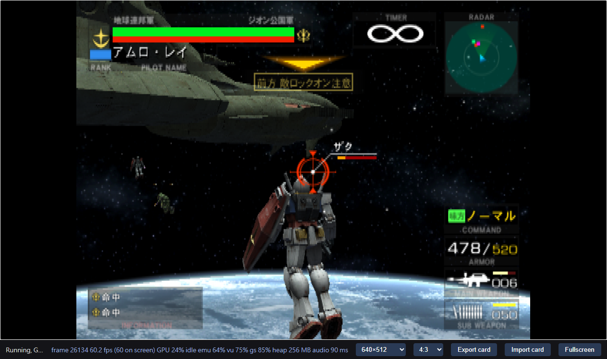
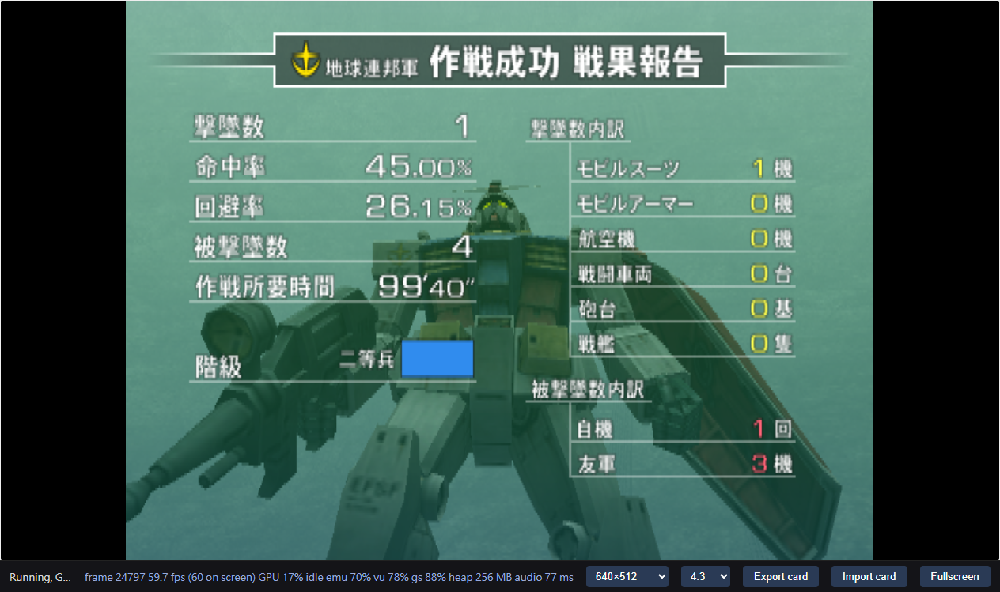
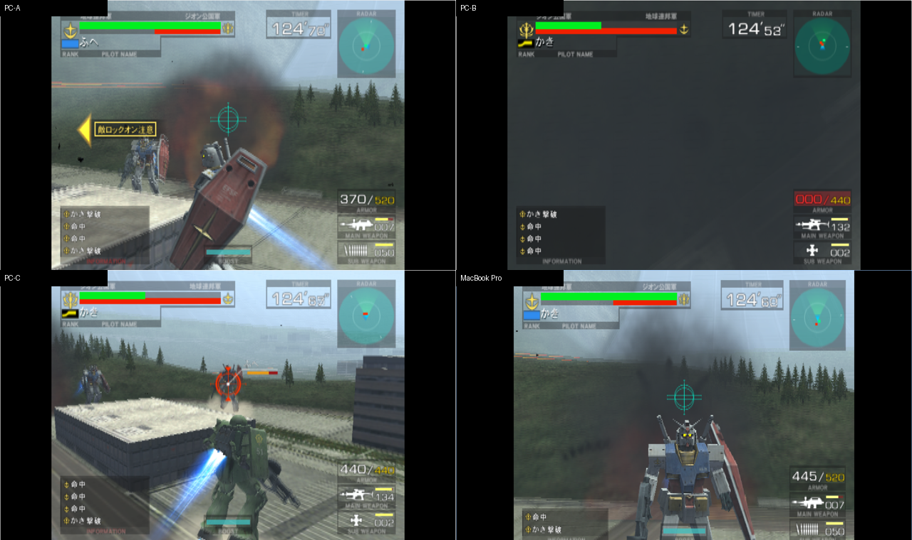
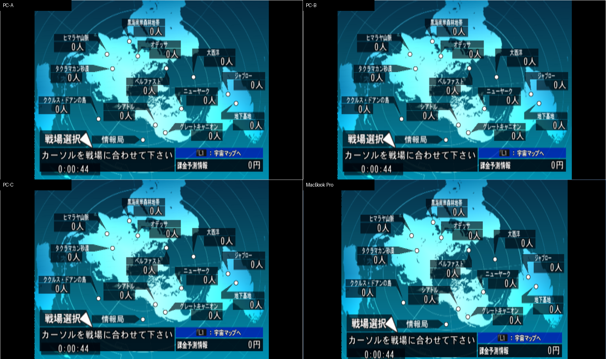

# 同一套方法，換一隻遊戲再驗證

由 <a href="https://sennett-lau.github.io/re-gvs-gvzg/">GVZG 嘅研究</a>出發，將 <strong>Kidou Senshi Gundam — Renpou vs. Zeon DX</strong> 重新編譯到瀏覽器。今次要回答嘅係：前一次建立嘅流程，有幾多可以重用？

> [!IMPORTANT]
> **`0.1.0` baseline 停喺可驗證嘅基本移植。** 範圍係原裝啟動、操作、Arcade 戰鬥、返回流程同必要修正，保留原裝時間模型。2026-11-09 嘅後續 Online Mode 實驗已完成兩部機、四個獨立 client 嘅 2v2 驗證；詳見下方 Further work。呢個 opt-in build 同私有 server 並未改動 baseline，亦未公開部署。

<figure class="hero-evidence">

<figcaption>實際 PC browser 截圖：Side 7 勝利後進入第二關。呢次流程測試使用原裝 difficulty 1 同 infinite timer；下方速度量測來自另一段獨立戰鬥紀錄。</figcaption>
</figure>

<strong>約 60 Hz</strong>已量測嘅 PC 戰鬥區間

<strong>0 個</strong>baseline compiler／runtime 專用修正

<strong>4 / 4</strong>乾淨重建輸出逐 byte 相同

## 01 · 由 GVZG 帶過嚟嘅方法

[GVZG](https://sennett-lau.github.io/re-gvs-gvzg/) 建立咗由 disc、R5900 指令、generated C++，再到 WebAssembly 同 browser runtime 嘅研究流程，之後先研究效能、畫面更新率同 multiplayer。FVZDX 嘅 baseline 重做嘅係**前面嘅基本移植流程**；後續連線實驗另外記錄喺第 06 節。

方法可以沿用，但每隻遊戲嘅 ELF、地址、callback、overlay 同 VU 程式都要重新確認。GVZG 嘅測試結果亦唔會自動變成 FVZDX 嘅證據。

<ol class="method-flow">
<li><b>確認輸入</b>Disc identity → ELF → pinned tools</li>
<li><b>重新編譯</b>R5900 → C++ → WebAssembly</li>
<li><b>實際驗證</b>Normal boot → 操作 → 戰鬥 → 返回</li>
</ol>

今次驗證嘅日本版 disc 係 `SLPM-65076`、`VER = 2.00`、NTSC。Compiler／runtime 固定喺 `6526f480…`；完整 identity 喺 [upstream.lock](../upstream.lock)。測試由正常開機開始，用真實鍵盤輸入，冇用 save state 跳入戰鬥。

## 02 · 邊啲 findings 用得返？

| GVZG 帶出嘅做法 | FVZDX 今次點驗證 | 結果 |
| --- | --- | --- |
| 固定工具版本，分開原始輸入、generated source 同 runtime | 獨立核對新 disc／ELF，保留每份 source 同 build 嘅 hashes | **用得返。** 可以知道實測緊邊份產物 |
| 唔可以將 compile 成功當成遊戲成功 | 由 normal boot 操作到選機、戰鬥、Continue 同返回主選單 | **用得返。** 必須有 runtime 證據 |
| 分開畫面 FPS、遊戲速度同音訊運行 | 用時間戳同 frame counter 計速；browser 靜音但 AudioContext 同 ring consumption 繼續 | **用得返。** 呢次戰鬥約 60 Hz |
| 保留 matched C++／WASM，同時做乾淨重建 | 新 build directory、重新編譯 retained C++，唔用舊 game objects | **用得返。** 四份 web 輸出逐 byte 相同 |
| 遊戲專用修正要有該遊戲嘅證據 | 冇移植 GVZG 嘅地址修正、overlay 或 adaptive hooks | **今次未需要。** 測過路線使用 pristine compiler／runtime |
| 觀察 VU 使用情況，唔好估 | 呢段 boot／menu／Side 7 路線冇錄到 VU1 程式；EE translation 有 VU0 macro operations | **要逐遊戲量。** 唔代表所有模式都冇 VU1 |

> [!IMPORTANT]
> **最有用嘅重用係流程同驗證方法。** FVZDX 呢次可以用未修改嘅 compiler／runtime 跑通指定路線；呢個結果唔需要套用 GVZG 嘅修正先成立。

補充嘅 [compiler 來源核對](evidence/compiler-provenance.json) 由同一個固定上游版本重新編譯：7 個 object files 同 `eerecomp`／`vurecomp` 兩個 binaries，都同保留嗰份逐 byte 一致。呢個支持「使用 pristine compiler」嘅講法，而唔只係睇有冇額外 patch。

### 原本嘅缺陷有冇再出現？

GVZG 要另外抽出 **325 個 MWo3 modules**，亦要修正 zero-filled memory 被當成固定 code、external tail call 被拒絕等問題，先跑通當時嘅路線。詳情見 [GVZG 嘅 code discovery 研究](https://sennett-lau.github.io/re-gvs-gvzg/01-disc-to-code.html)。

FVZDX 今次掃描兩個 AFS archives 嘅 entry headers，冇見到 MWo3／SNR2；已測過嘅流程亦冇出現 missing-code halt，所以冇搬過嚟用嗰套 module extractor 或 compiler patches。**呢個係「今次路線未需要」，唔係證明原本缺陷已經消失。** Header 掃描亦唔會排除更深層、壓縮咗嘅 code。

## 03 · 今次多咗咩新 finding？

### macOS 傳檔可以令 CMake 編譯錯檔

第一次將 generated C++ 傳到 PC 時，archive 帶咗 AppleDouble `._unit_*.cpp` 同 `._table.cpp`。上游 CMake 用 `*.cpp` 搜尋源碼，連呢啲 metadata 都揀埋；Clang 因而報 binary／null-byte 錯誤。

**修正放喺輸入驗證層。** 傳檔排除 sidecars，build 前再比對 generated manifest 嘅檔名、長度同 SHA-256。多咗、少咗或者內容改咗任何一份檔，都會停止。Vendor 保持原樣。

呢個係**具體嘅上游改善候選**：由 recompiler 輸出 manifest，再由 build 驗證；最少亦應拒絕 AppleDouble 檔，顯示可操作嘅錯誤。已經有唔需要遊戲資料嘅 regression test。詳細 trigger 同提案喺 [ps2-web-re-pr.md](../ps2-web-re-pr.md)，尚未提交 PR。

### 測試工具亦可以產生假象

- **固定等待時間會錯過 menu fade。** 一張叫 `battle-start` 嘅截圖，實際仍然係輸入 pilot 名稱。之後按真實畫面繼續操作，唔再用檔名判斷通過。
- **Optional favicon 404 唔係遊戲資料遺失。** Server 改為缺少 icon 時回傳 204，再用 fresh browser run 驗證。
- **WSL server 要有清楚生命週期。** 一次 SSH 呼叫結束後，背景 server 跟住退出。保留 serving session 後恢復；失敗紀錄仍然保留，唔會用中斷期間嘅數據計效能。
- **通用 RE 工具未必支援 PS2 MIPS。** 今次可用 provider 未能提供呢個架構嘅分析；dedicated R5900 recompiler 同檔案解析仍然完成移植。冇將工具拒絕支援寫成 decompile 成功。

呢啲發現改善咗重做流程嘅可靠性。測過嘅遊戲路線暫時冇重現新嘅 EE compiler／runtime correctness defect。

## 04 · 真正驗證到邊一步？

**✅ 已驗證 · 指定 PC Chrome／WebGPU 路線**

| 範圍 | 實測結果 | 證據 |
| --- | --- | --- |
| 開機同操作 | 原裝 menu、陣營／pilot／機體／武器選擇；移動、射擊、boost、pause／resume | [Baseline acceptance](evidence/acceptance-0.1.0.json) |
| 輸咗之後嘅流程 | Continue 倒數、Game Over、陣營結果、返回主選單 | [Baseline acceptance](evidence/acceptance-0.1.0.json) |
| 原裝速度 | 3,305 frames ÷ 55.07208 秒 = **60.01226 Hz**；音訊處理持續運行 | [Timing record](evidence/acceptance-0.1.0.json) |
| 勝利同下一關 | Side 7 success → stage 2 briefing → active space battle；difficulty 1、infinite timer | [Follow-up](evidence/baseline-followup.json) |
| 儲存同 reload | 原裝遊戲儲存 difficulty 2；同 browser profile／origin reload 後恢復，card bytes 相同 | [Follow-up](evidence/baseline-followup.json) |
| 重建 | 新 WSL workspace 重新編譯 retained C++；HTML、JS、WASM、data 全部相同 | [Rebuild](evidence/retained-source-rebuild.json) |

*勝利流程係後加嘅驗證，使用同一份 accepted build；唔係新增遊戲功能或者另一個 release。*

> [!NOTE]
> **證據範圍一次講清楚。** 呢份 baseline 只涵蓋列出嘅 PC 路線；未驗證全 campaign、其他模式、mobile、其他 GPU／browser、gamepad、跨 profile 存檔或原裝硬件逐 pixel 比對。測試一直靜音，驗證咗音訊運行，未評估聽感。約 60 Hz 係遊戲 frame counter 量測，唔係 physical display scan-out 證明。

## 05 · 保留咗咩，其他人點重做？

Repository 跟返 GVZG 將 code、matched build 同 evidence 分開嘅做法：

| 路徑 | 用途 |
| --- | --- |
| `generated/federation-vs-zeon-dx/` | 已驗證產物對應嘅 168 份 C++ 同一份 header，約 45.9 MB |
| `apps/game/prebuilt/` | Matched HTML／JS／WASM／data 同 manifest；WASM 約 17.4 MB |
| `scripts/game/` | Extract、regenerate、build、verify、serve 同 package |
| `docs/evidence/` | 精選測量、screenshots、input／build fingerprints |
| `research.md` | 英文技術紀錄、實際 commands、失敗同修正過程 |
| `ps2-web-re-pr.md` | 尚未提交嘅上游改善候選 |
| `.local/` | 忽略嘅 disc、private saves、完整 logs 同實驗 build |

C++ 同 matched web files 已經喺 Git。ISO／ROM、原裝 archive 同私人 card 唔會加入 repo。現有 game runtime 仍然需要另外提供受支援 disc 作資產來源；**呢個 research reader 只載入文件同證據圖片**。

想重做可以睇 [README 嘅 build／verify 指令](../README.md#local-workflow)。完整英文實驗次序見 [research.md](../research.md)；本頁係按研究問題整理嘅廣東話閱讀版，HTML 由 [呢份 Markdown](research.zh-HK.md) 生成。

## 06 · Further work：Online Mode 嘅後續實測

**2026-11-09 更新：私有跨裝置 proof of concept 已通過。** PC 跑三個獨立 browser client，MacBook Pro 跑一個；四個 client 透過私有 server 完成原裝 lobby 配對、選機、三場連續 2v2 對戰、上報結果，再返回 lobby。呢個係 baseline 之後另外要求嘅研究，使用 `--online` build；原本 `0.1.0` package 同 tracked C++ 保持不變。

### 同 GVZG 有咩相同同唔同？

[GVZG 嘅原裝連線研究](https://sennett-lau.github.io/re-gvs-gvzg/08-independent-clients.html) 提供咗獨立 client、原裝 lobby 同相容 server 嘅驗證方向。FVZDX 呢隻 disc 用較舊嘅 KDDI stack（`AVETCP.IRX`、`AVEPPP.IRX`、modem drivers），冇 DNAS 或獨立 network-settings program，所以冇直接搬 GVZG 嘅 network module adapter。

今次採用支援呢隻遊戲 PS2 protocol 嘅 **gdxsv**，再參考佢舊 PCSX2 patch 嘅 call sites。Build 先對實際 ELF 核對原裝指令同 symbols，再喺 generated C++ 嘅副本替換 20 個 call sites 同一個 dial entry。每個 game TCP stream 經一條 WebSocket、token-protected gateway 接去 gdxsv lobby 或 battle relay；原裝 lobby／battle protocol 繼續由遊戲處理。Backend 綁 loopback，跨裝置 gateway 只容許指定 tailnet peers。

詳細 hook table、固定版本同重做指令見 [Online Mode 技術紀錄](online-mode.md) 同 [server 操作說明](../apps/server/README.md)。

### 測試途中發現咗咩？

- **原裝對戰固定要四人。** 最初 PC 加 MacBook Pro 兩個 client 可以登入同入 MCS room，但停喺 pre-battle ping。Guest memory 同 runtime write watch 確認 `internet_to_modem` 寫死 participant mask `0x0F` 同人數 `4`，client 等緊其餘兩個位置。之後改用四個 client，冇修改遊戲人數邏輯。
- **讀 disc 太慢會觸發 relay timeout。** 兩個 MacBook Pro client 同時經約 0.66 MB/s tunnel 讀取 stage，超過 server 預設 30 秒 silent-peer limit。Backend patch 加咗可設定 timeout，預設仍然係 30 秒；成功嗰次用 120 秒，同時只喺 MacBook Pro 跑一個 client。遊戲本身嘅 loading wait 仍然有限，timeout 並唔能夠取代夠快嘅 disc source。
- **必須驗證跨機遊戲狀態。** 成功嗰次四個畫面 timer 一致；MacBook Pro client 嘅擊殺喺 PC kill feed 出現，server 收到三場結果，四個 client 都返回 lobby。MCS room 維持 709 秒；所有 collector 都冇 page error，battle stream 開啟期間平均約 60 fps。Browser 輸出全程靜音，AudioContext 同 audio ring consumption 持續運行。

*三個 PC client 加一個 MacBook Pro client。完整 build fingerprints、結果同截圖 hashes 見 [2026-11-09 實測記錄](evidence/online-mode-2026-11-09.json)。*

### 仲有邊啲未驗證？

呢次只證明指定 PC 同 MacBook Pro、Chrome 156、私有 server 嘅原裝四人流程可行。未驗證公開 hosting、其他裝置／browser、長時間穩定性、對戰中斷線或 backend restart 後恢復，亦未評估 latency 同操作手感。Lobby 閒置斷線後可以重新登入，唔代表對戰中斷亦已經處理好。

下一步應分開驗證對戰斷線／server restart、較長 session 同 disc loading 條件，再評估跨裝置延遲。Online Mode 仍然係獨立實驗，未有新 game release 或公開遊戲服務。Repository 同呢份研究 wiki 會分開發布，唔會透過 Pages 運行遊戲或 backend。

### 研究網站同 CI 嘅狀態（2026-11-10）

呢個帳戶嘅 GitHub-hosted Actions job 因為 billing lock 未能執行，原本手動觸發嘅 Pages workflow 保留，等限制解除再用。

自架 runner 嘅方向已經放棄。呢個 repo 係公開嘅，任何人開 PR 都可以改 workflow，令佢喺自架 runner 上面執行自己嘅程式碼；為咗避免呢個風險，唔再註冊任何 runner。

現時研究網站喺本機 build 同檢查連結，再推送到 `gh-pages` branch，由 GitHub Pages 內置嘅部署發布；呢個部署冇被 billing lock 阻擋。`v0.1.0` release 嘅 browser package 同 wiki archive 亦係本機 build 同核對 SHA-256 之後上載。詳細步驟見 [英文研究紀錄](../research.md#2026-11-10-manual-wiki-and-release-publishing)。呢項發布工作冇新增遊戲測試。
