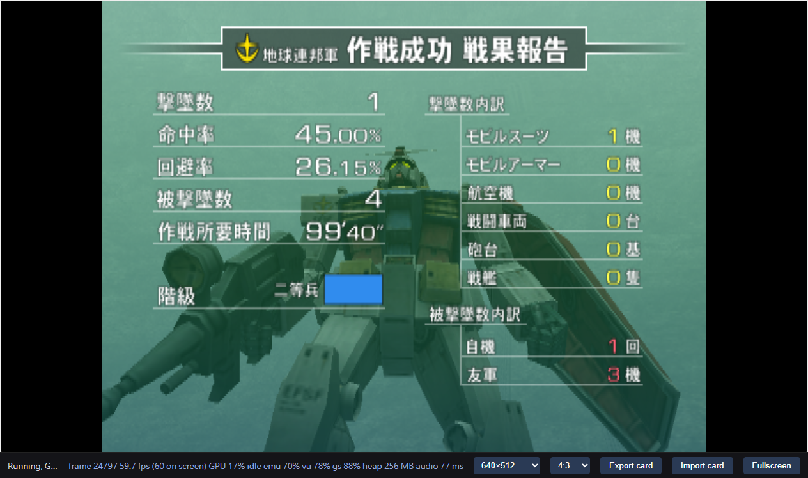
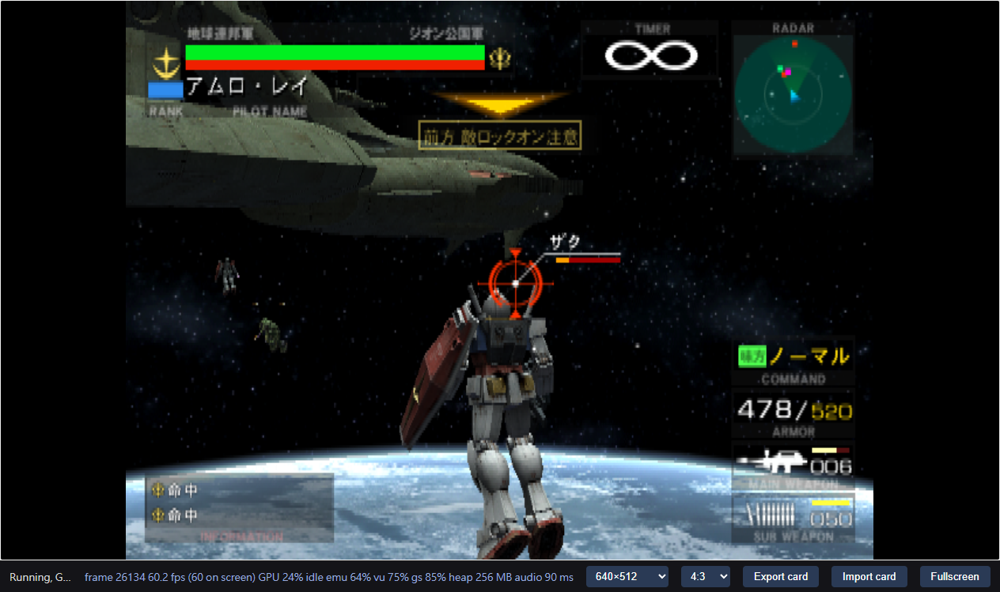
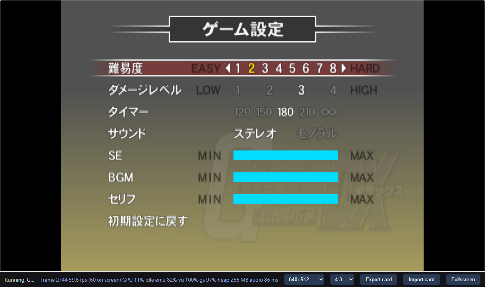

# Research record

For a question-led Cantonese reading experience, see the
[research reader source](docs/research.zh-HK.md). This English record retains
the detailed commands, chronological experiments and evidence limits.

## Scope

Reproduce the disc-to-C++-to-browser workflow established by
[GVZG](https://sennett-lau.github.io/re-gvs-gvzg/) for the supplied Japanese
v2.00 game. The research question is whether that workflow transfers, which
findings remain useful, and what new failures appear. Deliver a verified
`0.1.0` baseline, then only necessary `0.1.x` fixes. The baseline stops
at original-timing validation. A later request adds an opt-in Online Mode
experiment, recorded separately below; the accepted baseline remains unchanged.
The reader covers both stages without treating the experiment as a new release.

## Current status

The local `0.1.0` baseline passed the bounded normal-boot/Arcade/Side 7 gameplay
acceptance below, including controls and a completed loss/return flow. The
matched build and generated translation are now included in local Git; raw
captures remain ignored. Follow-up checks passed Side 7 victory into active
stage 2 and system/options save persistence across a same-profile page reload.
Other modes, campaign completion, browsers and cross-profile saves remain
unverified for the baseline. The later opt-in Online build passed a private
four-client 2v2 session across a PC and a MacBook Pro (three matches, results
and lobby return); see the dated Online Mode record below. Repository and wiki
publication setup is recorded at the end of this log.

## 2026-10-28: independent input and toolchain bring-up

The supplied 253,898,693-byte 7z archive contains a 4,282,515,456-byte ISO and a
small text file. Only the ISO was extracted into ignored `.local/disc/`, using
`7zz x -y -o.local/disc ARCHIVE '*.iso'`. Full SHA-256 values are in
`upstream.lock`: archive `8964d5b6…3df4e1`, disc `11023ffb…37fd579`.

The pinned upstream ISO reader reports one ISO 9660 layer, 2,091,072 sectors,
and an empty volume identifier. The actual `SYSTEM.CNF` names
`cdrom0:\SLPM_650.76;1`, `VER = 2.00`, `VMODE = NTSC`, and
`HDDUNITPOWER = NICHDD`. The ELF is 6,511,244 bytes, SHA-256
`222e5a12e9dbb7e5be674327b9e2f53abbaf75fd19fc9136c7a11879c2f3d092`,
little-endian ELF32 MIPS with symbols, entry `0x00100008`. Its initialized
read/write/execute load segment begins at `0x00100000`, has file size
`0x47fa80`, and memory size `0x9ace00`. A second non-executable segment has
zero file and memory size. The serial is `SLPM-65076`.

The disc has 40 files. `AFS_DATA.AFS` contains 1,629 entries and `G_ADX.AFS`
contains 2,319. A bounded scan of the first 16 bytes of each entry found no
MWo3 or SNR2 header. TIM2, HITS, model-like numeric headers, IPU movie and ADX
headers were observed. This does not prove the absence of nested or compressed
code. No overlay from the reference game is reused.

REA `open_binary` independently identified the same ELF SHA-256 and MIPS
architecture. Its `binary_overview` returned `capability_unavailable`: the
available providers do not admit this machine-specific PS2 MIPS variant.
The session was closed. No decompilation success is claimed; the dedicated
R5900 recompiler and explicit file parsing remain available.

The compiler/runtime source is exported from the local Git object
`6526f4803d98e10de50bea3af104a4d26e9df033`, with a per-file manifest. The retained
upstream working tree and reference project's adaptive package are not source
inputs. Required reference documentation, extraction/build/server scripts and
baseline/rebuild evidence were reviewed read-only. The reference's old native
round completion and later adaptive browser checks do not transfer to this game.

A later [compiler provenance check](docs/evidence/compiler-provenance.json)
compared all 88 vendor files with the pinned Git object and rebuilt both tools
from that source. All seven object files and both compiler binaries matched
the retained tools byte-for-byte. This confirms the pristine compiler lineage;
it adds no new gameplay result.

Initial commands on the Mac (two compile jobs):

```sh
cmake -S vendor/ps2-web-recomp -B .local/tools -G Ninja \
  -DCMAKE_BUILD_TYPE=Release -DCMAKE_CXX_COMPILER=/usr/bin/clang++
cmake --build .local/tools --target eerecomp vurecomp --parallel 2
.local/tools/eerecomp .local/inputs/SLPM_650.76 --out .local/generated-pristine
```

AppleClang 16.0.0 built both tools. Translation reported 668,526 instructions,
10,825 functions, 62,169 entries, zero rejected seeds and 167 units (about
44 MiB). No runtime execution is implied by those counts. The repeatable
`scripts/game/regenerate.py` extracts a verified ELF with its serial filename
and writes source/input fingerprints. `boot.txt` preserves the exact disc boot
path for the browser build.

SSH connectivity to the authorized PC is verified. The PC has Windows 11,
Core i9-12900K, 64 GiB RAM, RTX 3080 Ti plus UHD 770, and Chrome 156.0.8078.48.
WSL Ubuntu 22.04 is available; Clang 17 and Ninja are installed but CMake and
Emscripten were not on PATH. Project-local tool setup and a dedicated browser
profile/task are being prepared. Tests will use browser-output mute, with audio
processing intact. Private host/account details and raw captures stay in `.local`.

Setup observations: system Python on the Mac is 3.9; its `tarfile.extractall`
does not accept `filter=` and `/opt/homebrew/bin/python3` is absent. The vendor
export instead copies regular members from the known local Git archive.
Repository scripts target Python 3.9 or later. These setup failures did not
change the reference project.

### Repeatable scripts and first PC execution

The scripted regeneration matched all 169 files from the direct pristine
translation byte-for-byte. The local HTTP server passed 14 synthetic tests on
Python 3.9.6: range/HEAD semantics, isolation headers, WASM MIME, path bounds,
and strict 16,384-byte VU recording with non-overwriting conflict handling.
The PC harness passed an actual Chrome self-test: the captured browser command
line included `--mute-audio`, while AudioContext time advanced. That fixture is
a harness check, not game acceptance.

The PC build uses project-local CMake 3.31.6, Clang 17.0.3 and extracted libc++17
headers/libraries. A `std::format` probe passed. The native build uses ordinary
`-O1 -DNDEBUG`, six jobs on the PC, and the software GS (no window). A first
transfer accidentally included macOS AppleDouble `._*.cpp` sidecars; CMake
globbed them as source and compilation failed. Only those task-created sidecars
were removed. Later transfers use `COPYFILE_DISABLE=1 tar --no-xattrs`; the
builder now rejects a generated file set or hash differing from
`translation.json`. The corrected build linked `ps2run` in 200 build steps.

The first native command was:

```sh
PS2_VU_RECORD=RUN/vu1 PS2_DUMP=RUN/ram.bin PS2_DUMP_AUDIO=RUN/audio.wav \
  timeout 90s BUILD/native/ps2run INPUTS/SLPM_650.76 --disc DISC --ntsc \
  --misses RUN/misses.txt --memcard RUN/blank.ps2 --frames 900 \
  --press 300:start --press 600:circle --frames-dir RUN/shots --frame-every 150
```

It reached the requested 900-frame limit without a missing-code halt. The
frame-900 screenshot was inspected and shows the ADX startup logo. The newly
created card was unformatted. IOP reboot and modules loaded from this disc;
DEV9 reported unknown hardware, while the sound modules reached their startup
messages. No networking functionality is claimed. The stereo 48 kHz WAV
contained 430,336 frames, peak absolute sample 9,613, and 61,156 nonzero samples.
The headless runner produced no audible output. This only establishes startup
and nonzero native audio, not browser audio-ring pacing or gameplay.

The longer native run reached its requested 3,600-frame limit without a
missing-code halt. Frame 2,400 shows the pilot-name screen. No VU1 recording was
created during this bounded native menu path. The native executable is
19,364,032 bytes, SHA-256
`adf01cbb1c461421041ea0c9922da77781d048fe85ef244fa69c981b35d3f84c`.

### First browser journey and fresh build

Emscripten 6.0.11 was installed inside the PC's project workspace, SDK Git
revision `d7b4130688bfa348392b921ab04015aa15c4f154`, compiler revision
`a0014542110d6078c3a1a7941fa1ddb3a2281f16`. Python's SDK downloader hit TLS
failures; `EMSDK_USE_CURL=1` completed the same downloads. A small WASM program
compiled and ran before the game build. No global SDK/account settings changed.

Two fresh web workspaces were built through `scripts/game/build.py --target web
--translation .local/translation-pristine --jobs 6`. The native-only libc++
environment flags were cleared first. WASM, JavaScript and data were
byte-identical across both builds. Only the page title changed from the initial
candidate label to the game name. Artifacts:

| File | Bytes | SHA-256 |
| --- | ---: | --- |
| ps2web.wasm | 17,360,658 | `49bed2bc5fd253b752159779f4150e18d441143f13ddb38dd1f57638f58e8094` |
| ps2web.js | 151,840 | `636a2e1344c6dd32881edd86881ffaec99e53d730392454b69133223b3649728` |
| ps2web.data | 6,511,266 | `efc67275b871452f021038df43c008d52b32e7769ccd06f45600e01f501bc006` |

The first Chrome run used a new profile, the normal disc boot, a fresh card,
hardware NVIDIA WebGPU and `--mute-audio`. No save state or game-memory write
was used. The AudioContext remained running and the ring read pointer advanced.
Real keyboard input entered Arcade, selected Federation/Side 7, accepted the
default pilot name with Start, and selected Gundam with beam rifle for both
ground and space. The battle rendered mobile suits, scenery, radar, HUD and
the original timer. Movement changed position; two shooting inputs reduced
main ammunition from 10 to 9 to 8; Cross plus movement produced visible boost.
Pause screenshots kept the game timer at `106.00` while the runtime frame count
advanced. Resume restored the countdown. These observations support functional
controls, not pixel-perfect hardware emulation.

The run continued through a defeat animation and returned to the startup/title
flow, then accepted Start back to the main menu. The first pass did not capture
the short textual result/continue screen. It reached more than 50,000 runtime
frames without a page exception or missing-code halt. A 62.579-second interval
from the first battle capture to the pause capture advanced 3,756 frames
(approximately 60.02 Hz). This is the untouched upstream NTSC model with audio
consumption active, not adaptive/high-refresh rendering. The on-screen FPS
readout fluctuates; measurements use timestamped counter differences.

No VU1 program was recorded through this battle, and the exposed interpreted
VU counter remained zero. Generated EE code contains VU0 macro operations
(for example `ld128` into `c.vu0.vf` and `vu::mul(c.vu0, ...)`). No VU code from
another game is used. This bounded observation does not establish that every
mode has no VU1 microprogram.

The second fresh-profile run identified the two startup console resource errors
as `/favicon.ico` 404s. No game data request failure was established. The local
server now returns 204 for an absent optional favicon, with a synthetic GET/HEAD
regression, while still serving a real icon if supplied.

The second run's short fixed waits sent some inputs during selection fades,
so its screenshot names did not reliably identify the actual screen: a capture
named `battle-start` still showed pilot entry. This is a test-sequence failure,
not evidence of gameplay or a reproduced engine defect. Screenshot inspection
found the run later waiting at ground-weapon selection. The collector explicitly
does not decide acceptance from its exit status or labels. Subsequent operation
continues from the observed screen; acceptance is still pending final review.

## Record as work proceeds

1. Disc metadata, executable serial, sizes and SHA-256 fingerprints.
2. Pinned recompiler/runtime versions and the compatibility patches actually required.
3. Extraction and module discovery, EE translation and VU discovery/translation where needed.
4. Native and browser build commands, outputs and reproducibility boundaries.
5. Failures, reproduction steps, fixes and negative controls where useful.
6. Silent PC tests: hardware/browser context, normal boot, menus, inputs, active gameplay, audio processing and remaining limits.
7. Baseline acceptance and a truthful `0.1.x` fix history.

Keep the narrative here. Supporting code and selected non-private evidence may live beside the tests. Raw captures, private paths, network addresses and credentials stay in ignored local output. Upstream candidates belong in [ps2-web-re-pr.md](ps2-web-re-pr.md).

## 0.1.0 acceptance and retained evidence

The second new-profile run was continued from its observed weapon-selection
screen, then reached active Side 7 gameplay. Two-second captures preserved the
Continue countdown, Game Over, post-game faction summary and return to the
startup/title sequence. Start then returned to the original main menu. The
accepted evidence is based on inspected screens, not the failed early automation
labels. Run 001 ended at frame 50,745; run 002 ended at frame 44,888. Neither
reported a page exception or missing-code halt. The two pilots observed were
Amuro Ray and Sayla Mass; the tested suit/weapon was Gundam/beam rifle.

A third clean-profile normal boot verified the corrected server: no console
errors, page errors, failed resource entries or failed HTTP responses were
recorded. It reached the menu and passed another running-AudioContext/ring
consumption check. All three browser runs used the actual `--mute-audio` flag;
no system-volume change or suspended-audio timing shortcut was used.

For a battle interval excluding the pause transition, run 001 periodic samples
144–155 advanced from frame 28,373 to 31,678 in 55.07208 seconds: **60.01226 Hz**.
The runtime's original NTSC timing was unchanged. This is a bounded PC browser
measurement, not a hardware-cycle equivalence or cross-device performance claim.

[The acceptance manifest](docs/evidence/acceptance-0.1.0.json) fixes the input
lock, generated-file manifest, exact four web artifacts, hardware/browser,
checks, measurement and screenshot hashes. Selected screenshots:

| Observation | Evidence |
| --- | --- |
| Fresh normal boot and menu | [Menu](docs/evidence/normal-boot-menu.png) |
| Original mobile-suit selection | [Selection](docs/evidence/mobile-suit-selection.png) |
| Position and ammunition respond to input | [Movement/fire](docs/evidence/movement-and-fire.png), [boost/fire](docs/evidence/boost-and-fire.png) |
| Pause keeps the game timer at 106.00 | [Pause](docs/evidence/pause.png) |
| Completed loss and Continue expiry | [Continue](docs/evidence/continue.png), [Game Over](docs/evidence/game-over.png) |
| Post-game summary and usable return | [Faction summary](docs/evidence/faction-result.png), [main menu](docs/evidence/return-to-menu.png) |

The local package copies the matched HTML/JS/WASM/data, fingerprint manifest,
loopback range/isolation server, input lock, notices and selected evidence. It
excludes the disc, original archive, private saves and raw captures. The final
portable suite passed **16 tests** on Mac Python 3.9 and PC WSL Python 3.10.
The optional-icon fix was also exercised in actual Chrome. All task-owned game
browser contexts and scheduled tasks were closed/removed, and the PC test
server was stopped. The reference repository and its services were untouched.

### Limits of this baseline

The original acceptance covered the declared Arcade Side 7 loss/return journey, real keyboard
controls and original timing on Chrome 156 with the tested PC's RTX 3080 Ti.
At that point it did not cover campaign completion, wins, other stages/modes, browser/GPU or
mobile compatibility, gamepads, memory-card persistence, or audible audio
quality. Native nonzero samples and browser ring consumption are verified;
audible fidelity was deliberately not tested. Rendering was not compared
pixel-for-pixel with original hardware. No VU1 microprogram was observed on this
path, which does not exclude one in untested content. Later coverage is recorded
separately in the [follow-up checks](#2026-10-29-win-progression-and-savereload).

The compiler/runtime remain pristine. Necessary fixes discovered after this
baseline belong to `0.1.x`; no optimization/high-refresh, multiplayer or Wiki
work was introduced. The recorded upstream candidate concerns reproducible
build-input validation. No PR, push, public site, release or external contact
was made.

Final package verification checked every copied file against its manifest and
all four web files against the acceptance record. The standalone packaged
server was started on an ephemeral loopback port: HEAD reported the actual
4,282,515,456-byte disc, an HTTP 206 range at sector 311 matched the extracted
ELF's first 512 bytes, isolation headers were present, and absent favicon GET
returned 204. That verification server was then closed.

## Repository naming update

The local project folder and current project references now use `rg-gvs-fvzdx`.
New test harness identifiers and the local server label use FVZDX. Historical
acceptance run IDs, raw PC captures, fingerprints and the original `0.1.0`
package retain their recorded names and bytes. The game build and disc identity
are unchanged. Lobby import paths follow the renamed sibling directory; its
existing `rvzdx` protocol ID remains stable.

## Retained source and prebuilt export

The initial baseline committed build tools and fingerprints but left generated
game C++ and the matched web package in ignored workspaces. That did not carry
over GVZG's complete source/prebuilt export structure. The later export fills
this gap without changing any accepted game artifact or rewriting the old
`v0.1.0` tag.

All 169 generated files (168 C++ and one header, 45,855,118 bytes) are retained in
`generated/federation-vs-zeon-dx/`. The original `src/generated/manifest.json`
remains the canonical fingerprint record. `apps/game/prebuilt/` contains the
same four accepted web files and their unchanged historical build manifest,
24,072,200 bytes in total. The `.data` includes the original boot executable;
the complete disc, archives, private saves and raw captures remain excluded.

The new verifier compares retained source and vendor files, the build manifest
and the earlier gameplay acceptance. `build.py --disc` compiles retained C++
directly into a fresh workspace; `--translation` still builds a separately
regenerated candidate. Packaging defaults to the tracked accepted package.
Export verification is separate from the retained gameplay observations above.

### Fresh build from the retained source

On 2026-10-29, the tracked source set was exported into a new PC WSL directory.
`build.py --disc` verified the 169 retained generated files, extracted the boot
input and compiled with CMake 3.31.6, Ninja and Emscripten 6.0.11. It did not run
the recompiler or reuse previous game object files. The existing SDK and its
dependency cache were reused.

All four outputs—HTML, JavaScript, WASM and data—matched the accepted `0.1.0`
package byte for byte. This comparison uses the final accepted HTML, unlike the
earlier candidate comparison where the page title changed. The selected
[rebuild record](docs/evidence/retained-source-rebuild.json) includes exact script
and input hashes, toolchain versions, output sizes and output hashes. Raw logs
remain private. This is one successful fresh build on WSL, not a guarantee of
identical output across every toolchain or host.

The 16 portable tests and retained-source/package verifier passed after the
export. Packaging from the tracked prebuilt also passed its fingerprint checks.
Neither source export nor a byte-identical rebuild adds new game-path coverage;
the remaining runtime checks are tracked separately.

## 2026-10-29: win progression and save/reload

Two further silent PC runs used the fresh build whose four web files match the
accepted package. No game code, guest memory or clock was changed. The
[follow-up record](docs/evidence/baseline-followup.json) retains exact artifact
and capture hashes, inputs, audio checks, selected screenshots and cleanup.

| Check | Observed result | Conditions |
| --- | --- | --- |
| Win to next stage | Side 7 operation success, stage 2 briefing, active Satellite Orbit 1 space battle and usable pause | Original options set to difficulty 1 and infinite timer; real keyboard inputs |
| System/options save | The original game formatted a dedicated blank card and reported save complete | Fresh isolated profile; difficulty changed from 4 to 2 |
| Page reload | The game restored difficulty 2; exported card bytes matched before/after | Same browser profile and origin; no card import |
| Silent audio workload | All eight checks found running audio and advancing ring consumption | Browser output muted; no system-volume changes |







The win run recovered from a test-server outage before battle. A detached WSL
server exited when its SSH invocation ended; retaining the serving SSH session
fixed the connection. The record preserves its 9,237 console errors and request
failure categories. The success and next-stage checkpoints were captured after
recovery. The save run had no page, console or HTTP errors, with two untimed
aborted requests retained in its log. No new performance measurement spans
either interruption or reload.

This adds one win/progression path and same-profile system-data persistence.
Stage 2 completion, other modes, full campaigns, browser-process restart and
fresh-profile card import remain untested. The game binaries and original
`v0.1.0` tag are unchanged; these are additional validation commits, not a new
game release. Private card images and full captures remain ignored.

## 2026-11-08 to 2026-11-09: opt-in Online Mode proof of concept

This later request extends the project beyond the `0.1.x` baseline; the default
build and tracked package are unchanged. The full method, hook table, findings
and limits are in [docs/online-mode.md](docs/online-mode.md); selected evidence
is in [docs/evidence/online-mode-2026-11-09.json](docs/evidence/online-mode-2026-11-09.json).

The disc's network stack differs from GVZG's (`AVETCP.IRX`, `AVEPPP.IRX`,
modem drivers, `MCS_WRAP.IRX`; no DNAS or settings program). The server project
for this game, gdxsv (commit `46ee80b715f76ac0c7c254f6f983e5dcd9940306`),
already implements its PS2 lobby protocol. Its retired PCSX2 patch replaced 19
call sites into the AVE library, removed one form-check call, and redirected a
dial-table entry and a menu-table entry. All of those words were checked
against this ELF (`python3 scripts/game/online.py --elf ... --check-only`) and
matched exactly; the removed form-check call lies in the local function
`entry_move`, which a size-based symbol lookup had first misattributed.
`scripts/game/build.py --online` hooks a copy of
the tracked C++ (5 units) and links a main-thread WebSocket bridge. The backend
in `apps/server/` (built by a delegated agent, reviewed and then extended here)
runs patched gdxsv and a token-protected gateway.

Commands actually used:

```sh
python3 apps/server/backendctl.py --config .local/online/backend/config.json build --activate
python3 apps/server/backendctl.py --config .local/online/backend/config.json init
python3 apps/server/backendctl.py --config .local/online/backend/config.json start
# PC WSL, Emscripten 6.0.11 (work directory online-web-001 stopped when WSL idled)
python3 scripts/game/build.py --disc <private-disc.iso> --online --target web \
  --emsdk <emsdk-6.0.11> --work .local/online-web-002 --jobs 16
python3 scripts/game/serve.py --build .local/online-web-002/web --disc <private-disc.iso> \
  --port 8642 --online-config <private client.json>
```

Output hashes: `ps2web.wasm` `a2e84c9d…6599e6`, `ps2web.js` `1315c932…ba32058`,
`ps2web.data` `edf67f18…cd13e67c`; backend gdxsv `6416edf6…a56cb6a8`, gateway
`f1af1747…eddc5c2`.

Sequence of results:

1. One PC client reached the original lobby map on the first build: gdxsv
   received `lbsPlatformInfo`, created an account and served the lobby. A
   MacBook Pro client followed through a reverse tunnel for the page and the
   gateway's tailnet listener.
2. A two-player force start reached one MCS room, but both clients stalled in
   the pre-battle ping stage. Stream traces showed correct intro, ping and pong
   exchanges. Guest memory reads (`guest-peek`) and runtime store watches
   (`?PS2_WATCH=...`) showed the pong counters incrementing while the
   participant mask stayed `0x0F`; `internet_to_modem` writes that mask and the
   count `4` unconditionally. One early RAM reading used a wrong gp offset and
   was corrected before this conclusion. The original online battle is 2v2;
   no gameplay patch was added.
3. A four-client attempt (two per machine) reached the briefing on all four;
   the MacBook Pro clients then loaded the stage over a measured ~0.66 MB/s
   path for more than 30 s and gdxsv dropped them. The gdxsv patch now reads
   `GDXSV_BATTLE_READ_TIMEOUT` (default unchanged); the backend used `120s`.
4. With three clients on the PC and one on the MacBook Pro, gdxsv matched a 2v2
   lobby battle without force start. The four clients played three consecutive
   matches over 709 s with matching timers and cross-device kills, posted
   results to gdxsv and returned to the lobby map. All collectors were muted,
   kept audio running and consuming, showed no page errors and averaged 60 fps.

Not established: public hosting, more than these two machines, other
browsers, disconnect or backend restart during a battle, long sessions, and
play quality. Background SSH processes for the WSL keep-alive, game servers and
tunnels hit the agent's 30-minute limit twice; one interrupted a MacBook Pro
disc read, which recovered after the server was restarted.

## 2026-11-09: research reader update

The Cantonese reader now distinguishes the accepted baseline from the later
private Online Mode proof of concept: four independent clients on two machines,
three matches, results and lobby return. It retains the failed two-player and
slow-loading attempts and the untested disconnect, restart, longevity and
latency cases. The English current status and README reflect the same scope.

`scripts/build-wiki.mjs` renders seven pages from the canonical Markdown,
including the Online Mode record and backend instructions. The reader assets,
pinned Marked dependency, compiler-provenance record and font license are
retained in Git; generated output remains ignored in `.local/wiki/`.
Validation used `npm ci --ignore-scripts`, `npm run wiki:build`, JavaScript
syntax checks and a local HTML link/fragment check across all seven pages.
Online screenshot hashes were checked against the retained evidence manifest.
This documentation update adds no new gameplay test or publication.

## 2026-11-09: authorized repository and wiki publication

The user created `sennett-lau/re-gvs-fvzdx` and authorized pushing this project,
updating its description and hosting the research wiki. The destination was
verified as an empty public repository. Every outgoing commit used the approved
`sennett-lau <47737641+sennett-lau@users.noreply.github.com>` author and committer.
GitHub authentication is selected per command and verified with `GET /user`;
the shared active account and global Git identity are unchanged.

The Pages workflow follows the reference repository's manual-dispatch design:
Node 24, pinned Actions, `npm ci --ignore-scripts`, `npm run wiki:build`, a local
link/fragment and artifact-boundary check, then upload/deploy of `.local/wiki/`
only. The reference repository and its services were read-only. The wiki URL is
`https://sennett-lau.github.io/re-gvs-fvzdx/`. The publication scope is `main`
and the documentation site; it does not launch a public Online Mode backend,
push tags or create a release or PR.


## 2026-11-09: isolated runner diagnostic preparation

The first manual Pages attempt ([run 42510423196](https://github.com/sennett-lau/re-gvs-fvzdx/actions/runs/42510423196))
failed before build steps with an account billing-lock annotation. A self-hosted
runner is an experiment in providing compute, not an established workaround for
that account restriction. No successful Pages deployment is claimed here.

Separate local infrastructure now contains a default-inert, disposable Docker
runner diagnostic, a Mac controller and bounded SSH/API adapters. A patched
runner rejects jobs before action preparation and workflow steps; it collects
only bounded field-presence/type comparisons. This diagnostic does not solve
production job admission or prove raw-message-to-REST numeric identity binding.
The accepted shared Docker/WSL kernel limitation remains.

Offline validation reached 72 passing Python test methods, retained six compiled
diagnostic refusal/default-binding/update-denial tests, and dated PC evidence for
immutable package checks, fake-JIT delivery with no network, exact-owned cleanup
and an independent watchdog. Independent review identified and verified fixes
for lost sentinel evidence at correlation/deadline boundaries, malformed-row
scanning, and preserving the approved journal location. The final review accepts
only presenting the exact diagnostic version for a scoped authorization request;
it does not authorize a live run. Private infrastructure, approval data and raw
captures remain outside this repository.

The prepared `.github/workflows/runner-diagnostic.yml` is byte-identical to the
reviewed candidate (SHA256
`54d700ec1476480a1ac9adcbaded4e380aee8cbcfa46b34b9baf2ecc8551251c`).
It has only `workflow_dispatch`, no inputs, both owner-actor checks, fixed
repository/main guards, empty token permissions, one `observe` job and a
run/attempt/job routing label. Its sole sentinel must never execute. Publishing
and dispatching this workflow require explicit approval; actual runner
registration requires the exact approved run/attempt/job and reviewed package.
The existing Pages workflow has not been switched to the diagnostic runner.

Validation for this repository change: `npm run wiki:build`,
`python3 scripts/check-wiki.py`, `git diff --check`, and an exact SHA256 comparison
of the workflow against the reviewed candidate. No game test, authenticated API,
runner registration, workflow dispatch or site deployment was performed for
this preparation. Real REST/JIT behavior, billing capability and production
admission remain unverified.
